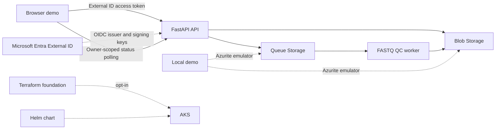

# Pangolin interviewer demo

## Project summary

Pangolin demonstrates an authenticated field-data intake pipeline. A browser
user signs in with Microsoft Entra External ID, submits a FASTQ file through a
FastAPI API, and sees its processing status and basic quality-control results.
The API stores the file in Blob Storage and queues a job; a separate worker
processes the queue asynchronously.

The repository also includes a Helm chart for AKS, an opt-in Terraform
foundation, workload-identity configuration, and GitHub Actions CI and manual
OIDC deployment workflows.

## Run the local demo

The demo requires Docker with Compose, a browser, and internet access for
External ID sign-in and the MSAL Browser library. It does not deploy Azure
compute or use Azure Blob/Queue Storage: those services are emulated locally by
Azurite. Sign-in still uses the configured External ID tenant; check the
tenant's billing terms before inviting additional users.

The `localhost` URL is only reachable on the computer running the demo, so it
is not a link to send to an interviewer. Share the
[source repository](https://github.com/Toni744/pangolin-field-api) and, for a
local walkthrough, run the demo on your computer and screen-share it. A separate
HTTPS-hosted instance has also been deployed for a limited interview window.

```bash
git clone https://github.com/Toni744/pangolin-field-api.git
cd pangolin-field-api
docker compose up --build -d
docker compose ps
```

Open [http://localhost:8081](http://localhost:8081), choose **Continue with
email**, then sign in with an account allowed by the Pangolin External ID user
flow. The app registration has `http://localhost:8081/` registered as a
Single-page application redirect URI; if that registration changes, set the
new exact callback URI in the tenant before sign-in. Select **Use a synthetic demo sample** and choose **Upload & queue analysis**.
The page displays the sample's progress through storage, queue, and worker
processing, followed by its QC metrics. After processing, the **Sample library**
shows the signed-in user's submitted samples and provides downloads for that
sample's original FASTQ file and QC report. The API scopes listing and downloads
to the authenticated user's identity; another user cannot retrieve those
objects by guessing a sample ID.

Useful checks and logs:

```bash
curl --fail http://localhost:8081/healthz
curl --fail http://localhost:8081/readyz
docker compose logs --follow worker
```

Stop the containers with `docker compose down`. To also remove local sample
data, run `docker compose down --volumes`.

## Walkthrough

1. **Authentication:** MSAL Browser uses authorization code with PKCE. The API
   validates the access token's signature, issuer, audience, required scope,
   and allowed client ID.
2. **Upload:** The API accepts the FASTQ sample and metadata, writes the sample
   to Blob Storage, and enqueues a processing job.
3. **Asynchronous processing:** A separate worker consumes the queue, validates
   FASTQ records, and calculates basic read, base, GC-content, and mean-quality
   metrics. Failed messages use retry and poison-queue handling.
4. **Status and results:** The browser refreshes the authenticated user's
   sample library, displays queued/processing/completed status and QC metrics,
   and enables original FASTQ and report downloads only after completion.
5. **Operations and deployment:** CI runs tests, linting, dependency and
   security scans, container build, Terraform validation, and Helm rendering.
   The manual release workflow uses GitHub OIDC and Helm to deploy to AKS when
   the required infrastructure and protected environment are configured.

## Architecture



## What is and is not deployed

The browser and API/worker flow have been exercised locally with Azurite and in
a temporary AKS deployment with Azure Storage and a container registry.
Sign-in uses the configured External ID tenant. The GitHub Actions deployment
workflow requires a separately configured self-hosted runner and has not been
used for the hosted deployment.

The Flutter client is not included; QC is intentionally basic and has not been
scientifically validated. Site/organization membership authorization,
operational dashboards and alert delivery, upload quotas/rate limits,
data-retention and backup policies, and incident/recovery procedures remain
future work. The temporary public HTTPS proxy is configured separately from the
Helm chart. Do not upload real patient or location data.

## Suggested interview framing

> I built Pangolin to demonstrate the path from an authenticated field-data
> upload to asynchronous processing. The local demo uses a real External ID
> sign-in flow with local Blob and Queue emulation, so the end-to-end workflow
> can be shown without provisioning Azure compute or Storage resources. The
> repository includes an AKS Helm chart, Terraform foundation, workload
> identity, and CI/deployment automation, while documenting the remaining
> operational and product work.

## Repository map

- `app/` — API, authentication, Blob/Queue storage, FASTQ QC, and worker.
- `demo/` — browser sign-in, upload, progress, and results interface.
- `tests/` — API, storage, worker, QC, and opt-in Azurite integration tests.
- `deploy/helm/pangolin/` — Kubernetes workloads and deployment configuration.
- `infra/terraform/aks/` — opt-in AKS and supporting Azure infrastructure.
- `.github/workflows/` — CI and manually triggered AKS release workflows.
- `architecture.mmd` — architecture source diagram.
